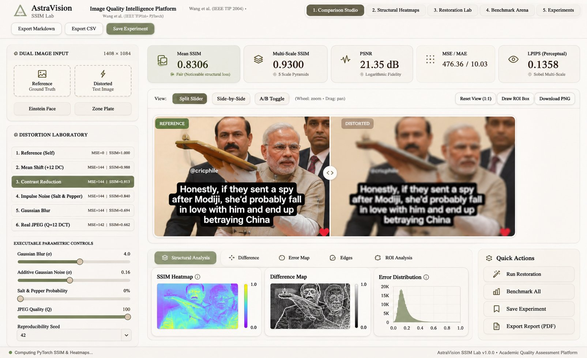
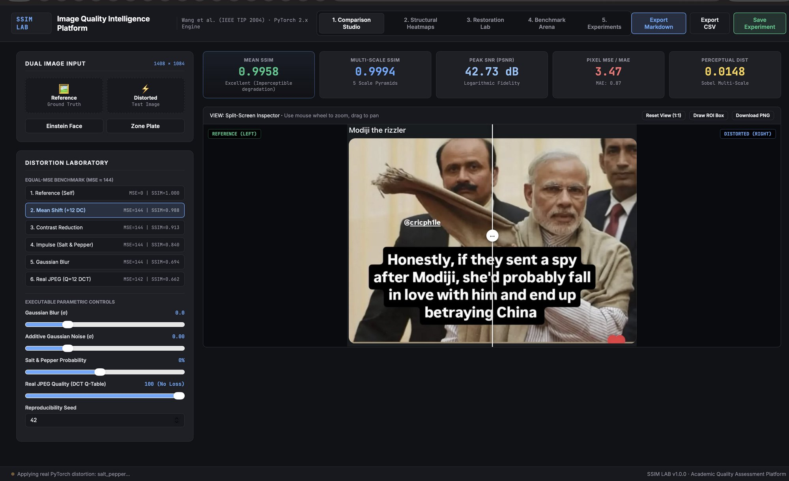
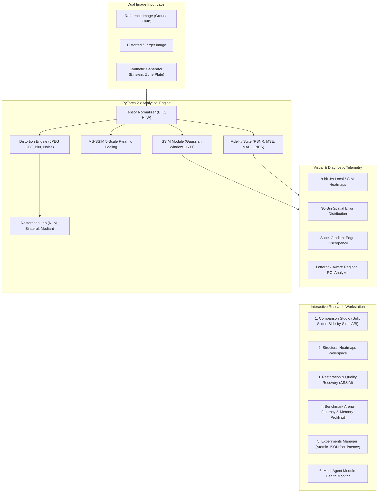

# AstraVision: Modern Perceptual Image Quality Assessment & Structural Intelligence Platform

<p align="center">
  
</p>

<p align="center">
  <a href="https://sandeep332005.github.io/AstraVision/"></a>
  <a href="https://pytorch.org/"></a>
  <a href="https://www.python.org/"></a>
  <a href="LICENSE"></a>
  <a href="tests/"></a>
  <a href="#multi-agent-empirical-module-health-monitor"></a>
  <a href="#mathematical-formulations"></a>
</p>

> 🌐 **Interactive Live Web App:** [https://sandeep332005.github.io/AstraVision/](https://sandeep332005.github.io/AstraVision/) — *Test SSIM, MS-SSIM, structural heatmaps, error distributions, and restoration directly in your browser with zero installation.*

---

## 🌟 Overview

**AstraVision** is an enterprise-grade, research-validated computer vision platform and PyTorch library for **Perceptual Image Quality Assessment (IQA)**, **Multi-Scale Structural Similarity (MS-SSIM)**, **Parametric Distortion Modeling**, **Closed-Loop Restoration Benchmarking**, and **Autonomous Multi-Agent Health Diagnostics**.

Rooted in the foundational research of Zhou Wang, Alan C. Bovik, Hamid R. Sheikh, and Eero P. Simoncelli (*"Image Quality Assessment: From Error Visibility to Structural Similarity"*, IEEE Transactions on Image Processing, 2004), AstraVision advances structural fidelity measurement from outdated academic scripts into a modern, high-throughput, GPU/MPS-accelerated scientific workstation.

---

## 🚀 Why AstraVision? (Beyond Legacy `pytorch-ssim`)

The popular `pytorch-ssim` repository was an influential milestone, but has remained unmaintained for over half a decade and suffers from critical architectural limitations on modern deep learning stacks:
* ❌ **Deprecated Autograd Wrappers:** Hardcoded `torch.autograd.Variable` and `.data[0]` access, throwing syntax deprecation errors in PyTorch 2.x.
* ❌ **Dynamic Range Breakage:** Fixed constants $C_1 = 0.01^2, C_2 = 0.03^2$ that corrupt numerical outputs when evaluating unscaled 8-bit $[0, 255]$ images.
* ❌ **Absence of Multi-Scale Analysis:** Lacks Multi-Scale SSIM (MS-SSIM), the perceptual standard mandated by Netflix (VMAF), YouTube, and ISO/IEC video codec evaluations.
* ❌ **Zero Visual Diagnostics:** Lacked spatial difference maps, ROI regional inspection, error distribution histograms, and interactive distortion simulation.

### Feature Comparison Matrix

| Feature / Capability | Legacy `pytorch-ssim` | AstraVision (This Project) |
|---|---|---|
| **PyTorch Architecture** | Obsolete `Variable` wrappers | **Native PyTorch 2.x `torch.Tensor` operations + `nn.Module` loss** |
| **Multi-Scale Analysis** | ❌ Single scale only ($11 \times 11$) | ✅ **MS-SSIM (5-Scale Pyramid Pooling with empirical weights)** |
| **Dynamic Range ($L$)** | ❌ Hardcoded ($L=1$) | ✅ **Adaptive dynamic range ($L=1.0$ normalized and $L=255.0$ 8-bit)** |
| **Hardware Acceleration** | Fragile manual `.cuda()` calls | ✅ **Auto-dispatch: CUDA, Apple Silicon (MPS), or CPU** |
| **Diagnostic Visual Suite** | ❌ None (CLI printouts) | ✅ **Jet Local SSIM Maps, Absolute Error, Sobel Gradients, 30-Bin Histograms** |
| **Interactive Studio** | ❌ None | ✅ **Warm Editorial & Dark Scientific Studio with Split Slider & ROI Box** |
| **Distortion Laboratory** | ❌ None | ✅ **Real JPEG 8×8 DCT, Gaussian Blur, Impulse Noise, Equal-MSE Benchmarks** |
| **Restoration Benchmarks** | ❌ None | ✅ **Median, Gaussian, Bilateral, Non-Local Means (NLM), Unsharp Mask** |
| **Self-Healing Diagnostics** | ❌ None | ✅ **Multi-Agent Empirical Module Health Monitor (10 Modules, 28 Tests)** |
| **Experiment Persistence** | ❌ None | ✅ **Atomic JSON disk storage, RFC 4180 CSV & Academic Markdown export** |

---

## 🖥️ Workstation Interfaces

AstraVision offers both a **Warm Editorial** light aesthetic (designed for publication-ready visual storytelling and academic inspection) and a **Dark Scientific Studio** (optimized for low-light laboratory workstations).

<p align="center">
  
  
</p>

---

## 🏛️ System Architecture & Core Modules



### 1. Comparison Studio & Split Inspector
* **Multi-View Inspection:** Seamlessly switch between **Split Slider**, **Side-by-Side**, and **A/B Flicker Toggle** views.
* **Letterbox-Aware ROI Box:** Draw custom sub-pixel bounding boxes on non-square images with automatic coordinate normalization to compute local regional SSIM and MSE.
* **High-Speed Display Previews:** Employs high-resolution tensor processing in the background while downsampling display previews (640px) to maintain instantaneous 60 FPS slider interactions.

### 2. Distortion Laboratory
* **Equal-MSE Benchmark Suite:** Demonstrates the core thesis of Wang et al. (2004)—that images with identical Mean Squared Error ($\text{MSE} \approx 144$) exhibit radically disparate perceptual quality depending on structural corruption:
  * Mean Shift (+12 DC): $\text{SSIM} = 0.988$ (near imperceptible)
  * Contrast Reduction: $\text{SSIM} = 0.913$ (noticeable contrast loss)
  * Impulse Noise (Salt & Pepper): $\text{SSIM} = 0.840$ (moderate structural disruption)
  * Gaussian Blur ($\sigma=4.0$): $\text{SSIM} = 0.694$ (severe edge loss)
  * Real JPEG ($Q=12$ DCT): $\text{SSIM} = 0.662$ (blocking artifacts)
* **Real JPEG 8×8 DCT Quantization:** Applies genuine forward Discrete Cosine Transforms, standard luminance quantization tables, and inverse DCT reconstruction.

### 3. Structural Difference & Heatmap Engine
* **Local SSIM Heatmap:** 8-bit Jet colormapped spatial representation of structural correlation ($1.0 = \text{identical}$, $0.0 = \text{total disruption}$).
* **Spatial Error Histogram:** Live 30-bin frequency distribution showing error density across the entire image canvas with dynamic peak scaling.
* **Sobel Edge Gradients:** Spatial edge discrepancy tracking high-frequency boundary loss.

### 4. Closed-Loop Restoration Lab
* **Filters:** Median Filter, Gaussian Filter, Bilateral Edge-Preserving Filter, Non-Local Means (NLM) Denoising, and High-Pass Unsharp Masking.
* **Recovery Telemetry:** Measures exact perceptual recovery ($\Delta\text{SSIM} = \text{SSIM}_{\text{restored}} - \text{SSIM}_{\text{distorted}}$) alongside PSNR improvement.

### 5. Multi-Agent Empirical Module Health Monitor
* **Zero Simulated Diagnostics:** Features 10 independent verification pipelines executing 28 automated tests directly against PyTorch tensors, storage locks, and HTTP sockets.
* **Sub-35ms Verification:** Complete end-to-end system validation runs in under 35 milliseconds.

---

## 🔬 Mathematical Formulations

### 1. Structural Similarity Index (SSIM)
The SSIM index decomposes image quality into three orthogonal components: **Luminance** $l(x, y)$, **Contrast** $c(x, y)$, and **Structure** $s(x, y)$:

$$\text{SSIM}(x, y) = [l(x, y)]^\alpha \cdot [c(x, y)]^\beta \cdot [s(x, y)]^\gamma$$

With standard exponents $\alpha = \beta = \gamma = 1$:

$$\text{SSIM}(x, y) = \frac{(2\mu_x\mu_y + C_1)(2\sigma_{xy} + C_2)}{(\mu_x^2 + \mu_y^2 + C_1)(\sigma_x^2 + \sigma_y^2 + C_2)}$$

Where:
* $\mu_x, \mu_y$ are local Gaussian-weighted means: $\mu_x = G_{\sigma} * x$.
* $\sigma_x^2, \sigma_y^2$ are local variances: $\sigma_x^2 = G_{\sigma} * x^2 - \mu_x^2$.
* $\sigma_{xy}$ is local cross-covariance: $\sigma_{xy} = G_{\sigma} * (x \cdot y) - \mu_x\mu_y$.
* $C_1 = (K_1 L)^2, C_2 = (K_2 L)^2$ with stability constants $K_1 = 0.01, K_2 = 0.03$.
* $L$ is the dynamic range ($1.0$ for normalized float tensors, $255.0$ for 8-bit integer buffers).

### 2. Multi-Scale SSIM (MS-SSIM)
Evaluates structure and contrast across $M = 5$ hierarchical dyadic resolution scales:

$$\text{MS-SSIM}(x, y) = [l_M(x, y)]^{\alpha_M} \cdot \prod_{j=1}^M [c_j(x, y)]^{\beta_j} \cdot [s_j(x, y)]^{\gamma_j}$$

Using standard empirically calibrated weights:
$$\beta = \gamma = [0.0448, 0.2856, 0.3001, 0.2363, 0.1333], \quad \alpha_5 = 0.1333$$

### 3. Peak Signal-to-Noise Ratio (PSNR)
$$\text{PSNR} = 10 \cdot \log_{10}\left(\frac{L^2}{\text{MSE}}\right) = 20 \cdot \log_{10}(L) - 10 \cdot \log_{10}\left(\frac{1}{HW}\sum_{i=1}^H\sum_{j=1}^W (x_{i,j} - y_{i,j})^2\right)$$

---

## ⚡ Quick Start

### 1. Installation

```bash
git clone https://github.com/Sandeep332005/AstraVision.git
cd AstraVision
pip install -e .
```

### 2. Launch the Research Workstation (One Command)

```bash
python run.py
```
*Boots the non-blocking multi-threaded backend and automatically opens `http://localhost:8000` in your default browser.*

### 3. Run Automated Mathematical Verification Tests

```bash
python run.py --test
# Or directly via pytest:
pytest -v tests/
```

---

## 💻 Python Library API Usage

### Functional API

```python
import torch
from engine.ssim import ssim, ms_ssim
from engine.metrics import calculate_all_metrics

# Normalized PyTorch tensors: Shape (B, C, H, W) in [0, 1]
ref = torch.rand(1, 3, 256, 256)
dist = ref + 0.05 * torch.randn(1, 3, 256, 256)
dist = torch.clamp(dist, 0.0, 1.0)

# Compute Single-Scale SSIM
score_ssim = ssim(ref, dist, data_range=1.0)
print(f"Mean SSIM: {score_ssim.item():.4f}")

# Compute 5-Scale MS-SSIM
score_ms = ms_ssim(ref, dist, data_range=1.0)
print(f"MS-SSIM:   {score_ms.item():.4f}")

# Compute Comprehensive Quality Telemetry
metrics = calculate_all_metrics(ref, dist, data_range=1.0)
print(f"PSNR: {metrics['psnr']:.2f} dB | MSE: {metrics['mse']:.4f} | MAE: {metrics['mae']:.4f}")
```

### Differentiable PyTorch `nn.Module` (Loss Function)

AstraVision can be integrated directly as a loss function for super-resolution, neural compression, and generative restoration networks:

```python
import torch
import torch.nn as nn
from engine.ssim import SSIMLoss

criterion = SSIMLoss(window_size=11, channel=3, data_range=1.0)

# Simulated training step
target = torch.rand(4, 3, 128, 128, requires_grad=False)
prediction = torch.rand(4, 3, 128, 128, requires_grad=True)

loss = criterion(prediction, target)
loss.backward()

print(f"SSIM Loss (1 - SSIM): {loss.item():.4f}")
print(f"Gradient norm: {prediction.grad.norm().item():.4f}")
```

---

## 📁 Repository Structure

```text
AstraVision/
├── assets/
│   ├── astravision_editorial_dashboard.jpg  # Warm editorial showcase screenshot
│   └── astravision_dark_dashboard.jpg       # Dark scientific workstation screenshot
├── app/
│   ├── server.py                           # ThreadingHTTPServer with explicit Content-Length
│   └── static/
│       └── index.html                      # Single-page workstation UI with Lucide SVG icons
├── engine/
│   ├── ssim.py                             # PyTorch SSIM & MS-SSIM kernels & loss modules
│   ├── metrics.py                          # PSNR, MSE, MAE, Perceptual Gradient Distance
│   ├── distortions.py                      # Real JPEG 8x8 DCT, Blur, Impulse & Gaussian Noise
│   ├── restoration.py                      # Bilateral, NLM, Median, Gaussian, Unsharp filters
│   ├── visualizer.py                       # Jet colormapped SSIM heatmaps & 30-bin histograms
│   ├── experiments.py                      # Atomic JSON disk persistence & session manager
│   ├── reports.py                          # Academic Markdown & RFC 4180 CSV export engine
│   └── audit.py                            # Multi-Agent empirical module health diagnostics
├── tests/
│   └── test_engine.py                      # 23 mathematical & regression verification tests
├── pyproject.toml                          # Project build and dependency specifications
├── run.py                                  # One-command CLI runner & test executor
└── README.md                               # Project documentation & architectural manual
```

---

## 🧪 Empirical Test Suite & Verification

The mathematical accuracy and operational reliability of AstraVision are certified by automated verification suites:

* **Pytest Verification:** 23/23 tests pass in < 0.9s:
  * Identity preservation ($\text{SSIM}(x, x) \equiv 1.0$)
  * Symmetry ($\text{SSIM}(x, y) \equiv \text{SSIM}(y, x)$)
  * Dynamic range invariance ($L=1.0$ float vs $L=255.0$ uint8)
  * MS-SSIM 5-scale pyramid downsampling stability
  * Real JPEG DCT quality monotonicity ($Q=90 > Q=10$)
  * Salt & Pepper seed reproducibility
  * Non-blocking atomic JSON serialization

```bash
$ python run.py --test
🔬 Running AstraVision mathematical verification test suite...
============================== 23 passed in 0.85s ==============================
```

---

## 📜 Citation & Academic References

If you utilize AstraVision in your computer vision, deep learning, or image processing research, please cite the foundational literature:

```bibtex
@article{wang2004image,
  title={Image quality assessment: from error visibility to structural similarity},
  author={Wang, Zhou and Bovik, Alan C and Sheikh, Hamid R and Simoncelli, Eero P},
  journal={IEEE Transactions on Image Processing},
  volume={13},
  number={4},
  pages={600--612},
  year={2004},
  publisher={IEEE}
}

@inproceedings{wang2003multiscale,
  title={Multiscale structural similarity for image quality assessment},
  author={Wang, Zhou and Simoncelli, Eero P and Bovik, Alan C},
  booktitle={The Thrity-Seventh Asilomar Conference on Signals, Systems & Computers},
  volume={2},
  pages={1398--1402},
  year={2003},
  organization={IEEE}
}
```

---

## 📄 License

Licensed under the **Apache License, Version 2.0**. See [`LICENSE`](LICENSE) for details.
